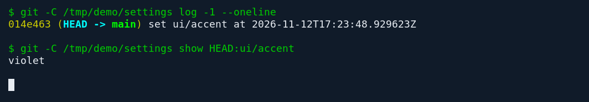

# ConfigService

ConfigService сопоставляет ключ пути HTTP с файлом в локальном Git-репозитории. POST записывает значение, GET возвращает его, DELETE удаляет. Изменения можно посмотреть обычными командами Git.


*Запись и чтение значения по HTTP*



*Коммит и сохранённое значение в Git*

## Запуск

Для изолированной локальной демонстрации нужны Python 3 и Git с настроенными именем и почтой автора. Передайте абсолютный путь к новому каталогу.

```bash
python3 configservice.py --repo "$(mktemp -d)" --port 8112
```

В другом терминале:

```bash
curl -X POST --data violet http://localhost:8112/ui/accent
curl http://localhost:8112/ui/accent
```

## Что проверено

В контейнере выполнены POST и GET, проверено содержимое коммита. Сервис слушает все интерфейсы, не проверяет пользователя и не ограничивает обход путей. Запускайте его только в изолированной среде с тестовыми файлами.

## Авторство

Вячеслав Георгиевич Кузнецов. GitVerse, задание 2.
